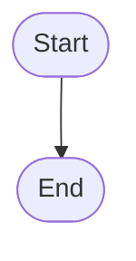

# TBCall Activity Diagrams

Dokumentasi lengkap workflow TBCall dalam format Mermaid diagram.

## 📊 Daftar Diagram

### 1. User Registration & Verification
**File:** `01-user-registration-verification.mmd`

Proses registrasi user baru:
- Input email/phone & password
- Validasi kredensial
- Generate verification token
- Send email/SMS
- Token verification & activation

### 2. Login & Session Management
**File:** `02-login-session.mmd`

Proses authentication:
- Credential validation
- Password check
- User status check
- Session token generation
- Role & permission loading

### 3. Patient Link Verification
**File:** `03-patient-link-verification.mmd`

Staff-assisted patient linking:
- Authorization check (TB Officer)
- Unique constraint validation
- Facility scope check
- Link verification
- Role assignment

### 4. TB Case Registration & Diagnosis
**File:** `04-tb-case-registration-diagnosis.mmd`

Complete workflow dari suspect hingga TB case:
- Patient creation/search
- TB Registration
- Lab request & specimen
- Lab testing & results
- Diagnosis creation
- TB Case confirmation

### 5. Treatment Management
**File:** `05-treatment-management.mmd`

Lifecycle pengobatan TB:
- Regimen selection
- Treatment creation
- Drug assignment
- Monitoring plan
- Daily dose recording
- Adherence monitoring
- Follow-up scheduling
- Adverse event handling
- Treatment outcome

### 6. Contact Investigation & TPT
**File:** `06-contact-investigation-tpt.mmd`

Contact tracing & preventive treatment:
- Contact identification
- Investigation workflow (internal/referral)
- Clinical examination
- Lab testing
- Result determination
- TPT eligibility check
- Preventive treatment

### 7. Referral & Transfer
**File:** `07-referral-transfer.mmd`

Referral antar faskes:
- Pre-treatment referral
- Treatment transfer
- Facility validation
- Status transitions
- Acceptance/rejection flow
- Case & treatment updates

### 8. Monitoring & Alert System
**File:** `08-monitoring-alert-system.mmd`

Automated monitoring system:
- Monitoring plan & events
- Alert generation rules
- Notification dispatch
- Multi-channel delivery (in-app, email, SMS, WhatsApp)
- Alert acknowledgment
- Resolution tracking

### 9. SITB Integration Sync
**File:** `09-sitb-integration-sync.mmd`

Bidirectional sync dengan SITB:
- Sync run creation
- Inbound/outbound direction
- Data fetching from SITB
- Entity mapping
- Conflict resolution
- External identifier management
- Sync status tracking

---

## 🎨 Cara Melihat Diagram

### Option 1: Mermaid Live Editor (Online)
1. Buka https://mermaid.live/
2. Copy-paste isi file `.mmd`
3. View diagram secara interaktif
4. Export sebagai PNG/SVG

### Option 2: VS Code
1. Install extension: **Mermaid Preview**
2. Buka file `.mmd`
3. Klik kanan → **Preview Mermaid Diagram**

### Option 3: GitHub
File `.mmd` akan otomatis di-render di GitHub:
```markdown
```mermaid
[diagram code]
```
```

### Option 4: Markdown File
Embed di dokumentasi `.md`:
````markdown

````

---

## 📦 Export Diagram

### Export PNG/SVG via Mermaid Live:
1. Buka diagram di https://mermaid.live/
2. Klik **Actions** → **PNG** atau **SVG**
3. Download file
4. Simpan ke folder `docs/diagrams/images/`

### Export via CLI (Node.js):
```bash
# Install mermaid-cli
npm install -g @mermaid-js/mermaid-cli

# Generate PNG
mmdc -i 01-user-registration-verification.mmd -o output.png

# Generate SVG
mmdc -i 01-user-registration-verification.mmd -o output.svg
```

---

## 🔄 Update Diagram

Jika ada perubahan workflow:

1. Edit file `.mmd` yang sesuai
2. Test di Mermaid Live Editor
3. Commit perubahan:
   ```bash
   git add docs/diagrams/*.mmd
   git commit -m "docs: update activity diagram for [workflow name]"
   git push
   ```

---

## 📚 Referensi

- **Mermaid Documentation:** https://mermaid.js.org/
- **Mermaid Live Editor:** https://mermaid.live/
- **Flowchart Syntax:** https://mermaid.js.org/syntax/flowchart.html
- **TBCall Architecture Docs:** `docs/architecture/`

---

## 🎯 Konvensi

### Node Types:
- `([Text])` - Start/End (rounded)
- `[Text]` - Process (rectangle)
- `{Text}` - Decision (diamond)

### Arrow Labels:
- `-->|Yes|` - Conditional true
- `-->|No|` - Conditional false
- `-->` - Flow continues

### Naming:
- Node IDs: `ActionName1`, `ActionName2`
- Clear, descriptive labels
- Bahasa Indonesia untuk user-facing text
- English untuk technical terms

---

Created: 2026-10-06
Last Updated: 2026-10-06
Version: 1.0
